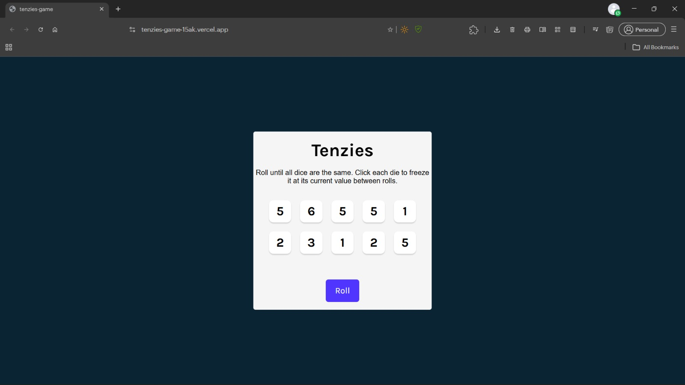
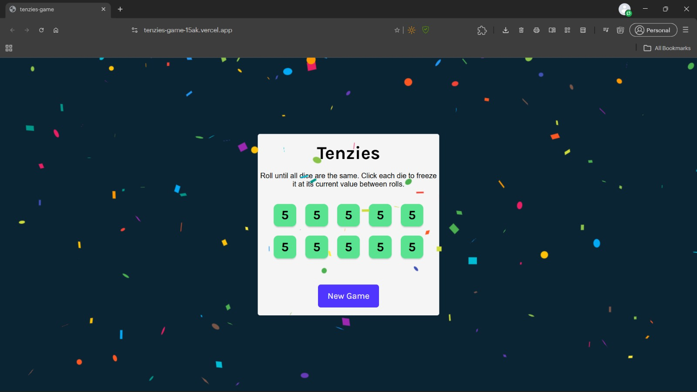

# 🎲 Tenzies Game

A fun and interactive dice game built with **React** and **Vite**. Roll the dice, hold your matching numbers, and try to get all ten dice showing the same number to win!

🌐 **Live Demo:** [Play Tenzies Game](https://tenzies-game-15ak.vercel.app/)

[](https://react.dev/)
[](https://vite.dev/)
[](https://developer.mozilla.org/en-US/docs/Web/JavaScript)
[](LICENSE)

---

## 📸 Screenshots

### Homepage


### Winning Screen


---

## ✨ Features

- 🎲 **10 Interactive Dice:** Play with ten randomly generated dice.
- 🎯 **Hold Dice:** Click individual dice to hold or release their current values.
- 🔄 **Roll Dice:** Roll all unheld dice while keeping your selected dice unchanged.
- 🏆 **Win Detection:** Automatically detects when all ten dice show the same number and are held.
- 🎉 **Winning Celebration:** Enjoy a confetti animation when you win.
- 🔁 **New Game:** Start a fresh game after winning.
- ⚡ **Fast Performance:** Powered by React and Vite.

---

## 🎮 How to Play

1. Start the game with ten randomly generated dice.
2. Click a die to hold its current number.
3. Click the **Roll** button to roll all dice that are not held.
4. Continue holding matching numbers and rolling the remaining dice.
5. Get all ten dice showing the same number and hold them to win!
6. Click **New Game** to play again.

**Goal:** Make all ten dice display the same number.

---

## 🛠️ Tech Stack

| Technology | Purpose |
|---|---|
| React 19 | Building the user interface |
| Vite | Development server and build tool |
| JavaScript (ES6+) | Game logic and functionality |
| CSS3 | Styling and layout |
| Nanoid | Generating unique dice identifiers |
| React Confetti | Winning celebration animation |

---

## 🚀 Getting Started

Follow these steps to run the project locally.

### Prerequisites

Make sure you have the following installed:

- [Node.js](https://nodejs.org/)
- npm (included with Node.js)
- Git

### 1. Clone the repository

```bash
git clone https://github.com/sairam-saridi/tenzies-game.git
```

### 2. Navigate to the project directory

```bash
cd tenzies-game
```

### 3. Install dependencies

```bash
npm install
```

### 4. Start the development server

```bash
npm run dev
```

Open the local URL displayed in your terminal (usually `http://localhost:5173/`) to play the game.

---

## 📦 Available Scripts

| Command | Description |
|---|---|
| `npm run dev` | Starts the development server |
| `npm run build` | Creates an optimized production build |
| `npm run preview` | Previews the production build locally |
| `npm run lint` | Runs ESLint to check code quality |

---

## 📁 Project Structure

```text
tenzies-game/
│
├── docs/
│   └── screenshots/
│       ├── homepage.jpeg
│       └── game-won.jpeg
│
├── src/
│   ├── App.jsx
│   ├── Die.jsx
│   ├── index.css
│   └── index.jsx
│
├── .gitignore
├── eslint.config.js
├── index.html
├── LICENSE
├── package.json
├── package-lock.json
├── README.md
└── vite.config.js
```

---

## 🌐 Deployment

This application is deployed using **Vercel**.

🔗 **Live Application:** https://tenzies-game-15ak.vercel.app/

---

## 📄 License

This project is licensed under the [MIT License](LICENSE).

---

## 👨‍💻 Author

**Sairam Saridi**

- GitHub: [@sairam-saridi](https://github.com/sairam-saridi)
- Project Repository: [tenzies-game](https://github.com/sairam-saridi/tenzies-game)
- Live Demo: [Tenzies Game](https://tenzies-game-15ak.vercel.app/)

---

⭐ If you enjoyed this project, consider giving the repository a star!

**Built with React and ❤️**
